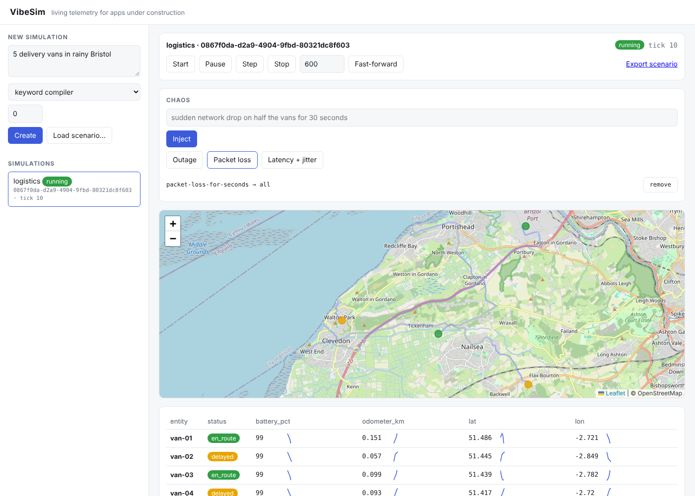

# VibeSim

**Living telemetry for apps under construction.** Describe a world in one sentence, and VibeSim runs it as a stateful simulation that streams realistic, story-driven data over SSE, WebSocket, MQTT, Prometheus or OpenTelemetry. Once compiled, it runs fully offline.

```bash
pip install vibesim
vibesim run "5 delivery vans in rainy Bristol"
```

```
  simulation  0867f0da-… (logistics, 5 entities)
  console     http://127.0.0.1:8000/?sim=0867f0da-…
  stream      http://127.0.0.1:8000/simulations/0867f0da-…/stream
  websocket   ws://127.0.0.1:8000/simulations/0867f0da-…/ws
```



Mock data is usually static JSON or random numbers. VibeSim gives a dashboard something worth showing:

- **Five built-in domains:** delivery fleets on **real road routes**, microservices that leak memory and restart, smart buildings with thermostats, online stores that sell out, and markets with order books.
- **Any other world in plain YAML:** drifting, mean-reverting, cyclic and derived fields, plus status state machines. Or ask Claude to design one (`--compiler claude`).
- **Chaos on demand:** `"sudden network drop on half the vans for 30 seconds"`, ramps, latency and jitter, scripted incident timelines, seeded random incidents.
- **Time control:** compressed days, fast-forward, snapshots that survive restarts, and recordings that replay event-for-event.
- **Fits your stack:** a browser client, MQTT, Prometheus `/metrics`, OpenTelemetry, a Python library and a pytest fixture.

```python
from vibesim import Engine, compile_prompt, Anomaly

engine = Engine(compile_prompt("3 services with a memory leak", seed=1))
engine.advance(600)
engine.inject(Anomaly(name="outage", drop_rate=1.0, duration_ticks=30))
```

**Docs:** https://jfrusher.github.io/VibeSim/: the [quickstart](docs/quickstart.md), [describing a world](docs/worlds.md), [chaos](docs/chaos.md), [integrations](docs/integrations.md) and the [config reference](docs/reference/config.md).
**Examples:** [`examples/`](examples) has a scenario per domain, a React dashboard, pytest usage, and Prometheus and MQTT recipes.

## Development

```bash
pip install -e ".[dev]"
ruff check . && ruff format --check . && mypy && pytest && mkdocs build --strict
```

MIT licensed. See [CONTRIBUTING.md](CONTRIBUTING.md), [CHANGELOG.md](CHANGELOG.md) and [ROADMAP.md](ROADMAP.md).
